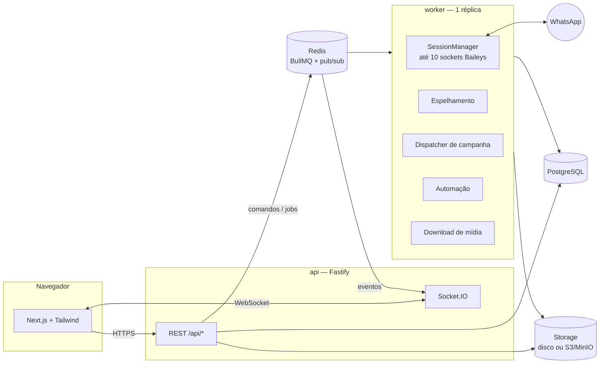
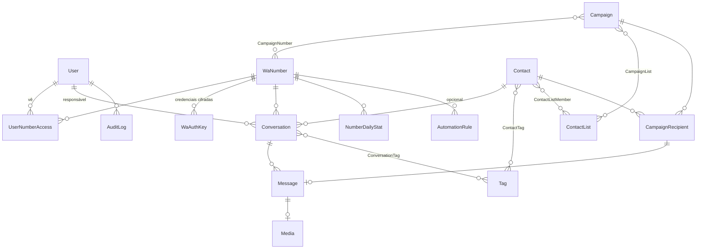

# Fase 1 — Arquitetura, modelo de dados e estrutura de pastas

Plataforma self-hosted de disparo e atendimento via WhatsApp, conectando até 10 números por QR Code (Baileys), com todas as conversas espelhadas no painel.

## 1. Decisões principais

| Tema | Decisão | Motivo |
|---|---|---|
| Conexão WhatsApp | **Baileys 7** (`baileys@7.0.0-rc14`, versão fixada) | Conexão direta por WebSocket, sem navegador: ~50 MB de RAM por sessão contra ~500 MB do WPPConnect (Chromium). A v7 trata os identificadores LID, que o WhatsApp vem adotando no lugar do telefone. |
| Backend | **Fastify 5** + TypeScript (ESM) | Baileys 7 é ESM puro; Fastify é leve e não exige a camada de DI do NestJS para um time pequeno. |
| Processos | `api` e `worker` separados, mesma base de código | A API fica sem estado e pode reiniciar sem derrubar as sessões do WhatsApp. |
| Dono das sessões | **Somente o `worker`** abre sockets Baileys | Uma sessão aberta em dois processos é derrubada pelo WhatsApp (conflito 440). Por isso o worker roda com 1 réplica. |
| Banco | PostgreSQL 16 + Prisma 6 | Prisma 6 é a linha estável; a 7/8 muda a configuração e ainda está em RC. |
| Fila | Redis 7 + BullMQ | Jobs com atraso (pacing do disparo), retentativas e agendamento. |
| Tempo real | Socket.IO na API, alimentado por Redis pub/sub | O worker publica eventos; a API repassa às salas certas. |
| Mídia | Interface `Storage` com driver `local` (volume) ou `s3` (S3/MinIO) | Troca por variável de ambiente. |
| Frontend | Next.js (App Router) + Tailwind | Pedido no escopo; fala com a API por REST + Socket.IO. |

## 2. Visão geral



### Comunicação entre API e worker

- **API → worker (comandos):** filas BullMQ. Nada é chamado diretamente; se o worker estiver fora, o comando espera na fila.
- **worker → API → navegador (eventos):** o worker publica no canal Redis `events`; a API assina e emite via Socket.IO para as salas `number:{id}` e `conversation:{id}`. A API só coloca o usuário nas salas dos números que ele pode ver.

| Fila | Produtor | Função |
|---|---|---|
| `session` | API | `connect`, `disconnect`, `logout`, `delete` de um número |
| `outbound` | API, automação | Envio avulso (resposta do painel, resposta automática). Concorrência 1 por número. |
| `campaign-control` | API, agendador | Montar a lista de destinatários e colocar a campanha em andamento |
| `media` | worker | Download e gravação das mídias recebidas |
| `contacts` | API | Importação CSV/Excel e verificação `onWhatsApp` em lotes |

## 3. Fluxos críticos

### 3.1 Sessão e QR Code
1. Painel cria o número (API recusa o 11º: contagem de `WaNumber` com `deletedAt = null`, dentro de transação com lock).
2. API enfileira `session:connect`. O worker abre o socket com o estado de autenticação lido do Postgres (`WaAuthKey`, cifrado com AES-256-GCM).
3. Baileys emite o QR → worker publica `number.qr` → painel mostra. O QR expira e é renovado a cada ~20 s; após alguns ciclos sem leitura o worker desiste e volta a `DISCONNECTED`.
4. Pareado: status `CONNECTED`, `autoConnect = true`.
5. **Boot do worker:** reconecta todo número com `autoConnect = true`, com intervalo entre eles para não abrir 10 conexões no mesmo segundo.
6. Queda: reconexão com backoff exponencial. Exceções: `loggedOut` (401) limpa as credenciais e pede novo QR; 403 marca `BANNED` e não tenta de novo.

### 3.2 Espelhamento
- `messages.upsert` traz mensagens recebidas **e** as enviadas por outros aparelhos da conta (`fromMe = true`). Se o `waMessageId` não foi gerado pelo sistema, a origem é `PHONE` (celular ou WhatsApp Web).
- `messaging-history.set` traz o histórico inicial após o pareamento.
- `messages.update` e `message-receipt.update` atualizam entregue/lido.
- Idempotência: `@@unique([numberId, waMessageId])` + upsert. O mesmo evento pode chegar duas vezes sem duplicar.
- Mídia: a mensagem é gravada na hora com `Media.status = PENDING`; o download roda na fila `media` e o painel é avisado quando termina.

### 3.3 Disparo (campanha)
A fila durável é a tabela `CampaignRecipient`. O ritmo de cada número fica gravado em `WaNumber.nextSendAt`, e um laço no worker (a cada 2 s) dispara o próximo envio dos números cujo horário chegou. Na fase 4 isso substituiu a ideia inicial de um job BullMQ por tique: o estado no banco sobrevive a reinícios sem depender do Redis.

1. Ao iniciar, o worker resolve o público (listas + filtro), remove blacklist, opt-outs e números sem WhatsApp, e grava os destinatários como `QUEUED`.
2. Cada número participante tem um tique próprio. A cada tique o número:
   - confere janela de envio, limite diário (com rampa de aquecimento), pausa automática e status da campanha;
   - faz *claim* do próximo destinatário (`FOR UPDATE SKIP LOCKED`) — o rodízio sai naturalmente daí, e se um número cair os outros seguem com a fila;
   - dá preferência a contatos que já têm conversa com aquele número;
   - simula "digitando…" por um tempo proporcional ao texto, envia, registra;
   - agenda o próximo tique com atraso aleatório entre `minDelayS` e `maxDelayS`, ou a pausa longa a cada N mensagens.
3. Pausar/cancelar muda só o status no banco; o próximo tique vê e para.
4. N falhas seguidas ou queda da taxa de entrega → número vira `SUSPECT`, para de disparar e o painel alerta.

### 3.4 Opt-out
Mensagem recebida que seja exatamente uma das palavras configuradas (padrão `SAIR`, `PARAR`, `STOP`, sem diferenciar caixa/acento) → telefone entra em `BlacklistEntry`, `Contact.optedOutAt` é marcado, destinatários pendentes viram `SKIPPED` e o contato recebe uma confirmação única.

### 3.5 Automação
Avaliada no worker a cada mensagem recebida em conversa individual, nesta ordem: opt-out → conversa com automação pausada? → regras por palavra-chave (prioridade) → fora do horário. Qualquer envio humano (painel ou celular) preenche `automationPausedAt`; a automação volta quando a conversa é fechada.

## 4. Modelo de dados

Schema completo em [`apps/api/prisma/schema.prisma`](../apps/api/prisma/schema.prisma) (validado com `prisma validate`).



| Grupo | Tabelas | Observações |
|---|---|---|
| Segurança | `User`, `RefreshToken`, `AuditLog`, `Setting` | Senha em argon2id; segredo TOTP cifrado; refresh token rotativo guardado como hash. |
| Números | `WaNumber`, `WaAuthKey`, `UserNumberAccess`, `NumberDailyStat` | Status, limites e aquecimento ficam no número; contadores diários alimentam limite e dashboard. |
| Contatos | `Contact`, `Tag`, `ContactTag`, `ContactList`, `ContactListMember`, `BlacklistEntry`, `ImportJob` | Telefone único em E.164 sem `+`. Blacklist separada de `Contact` para sobreviver a exclusão e reimportação. |
| Conversas | `Conversation`, `ConversationTag`, `ConversationEvent`, `Message`, `Media` | Uma conversa por par (número, chat). `Message.source` distingue recebida, painel, celular, campanha e automação. |
| Campanhas | `Campaign`, `CampaignNumber`, `CampaignList`, `CampaignRecipient` | Um destinatário por contato por campanha; guarda o texto final enviado. |
| Automação | `AutomationRule` | Palavra-chave ou fora do horário; ação responder ou encaminhar. |

Chaves de `Setting`: `businessHours`, `optOut` (palavras + mensagem de confirmação), `antiBanDefaults`, `warmupCurve`, `failureThresholds`.

## 5. Perfis de acesso

| Recurso | Admin | Gestor | Atendente |
|---|---|---|---|
| Usuários, configurações, auditoria | ✔ | — | — |
| Números (criar, conectar, limites) | ✔ | ✔ | — |
| Contatos, listas, blacklist, campanhas, automações | ✔ | ✔ | — |
| Dashboard | ✔ | ✔ | só os próprios números |
| Conversas | todas | todas | só dos números em `UserNumberAccess` |

O filtro do atendente é aplicado no servidor em toda consulta e na entrada das salas do Socket.IO — nunca só na interface.

## 6. Segurança

- **Credenciais de sessão:** cada valor de `WaAuthKey` é cifrado com AES-256-GCM usando `ENCRYPTION_KEY` (32 bytes, só no `.env`). Um dump do banco sem a chave não permite sequestrar as sessões.
- **Autenticação:** access token JWT curto (15 min) + refresh token rotativo em cookie `httpOnly`. 2FA TOTP opcional com códigos de recuperação.
- **Entrada:** validação com Zod em todas as rotas; rate limit no login; uploads com limite de tamanho e lista de tipos aceitos.
- **Auditoria:** login, mudanças em números, campanhas, usuários, blacklist e configurações.

## 7. Estrutura de pastas

```
.
├── docker-compose.yml            # fase 6: web, api, worker, postgres, redis (+ minio opcional)
├── .env.example
├── package.json                  # npm workspaces
├── docs/
├── apps/
│   ├── api/                      # backend — a mesma imagem roda como "api" ou "worker"
│   │   ├── prisma/
│   │   │   ├── schema.prisma
│   │   │   ├── migrations/
│   │   │   └── seed.ts           # cria o primeiro admin e as configurações padrão
│   │   └── src/
│   │       ├── server.ts         # entrada da API (Fastify + Socket.IO)
│   │       ├── worker.ts         # entrada do worker (sessões + filas)
│   │       ├── config/           # env (Zod), constantes
│   │       ├── lib/              # prisma, redis, logger, crypto, storage/, queues, events
│   │       ├── whatsapp/         # tudo que toca o Baileys — só o worker importa
│   │       │   ├── session-manager.ts
│   │       │   ├── auth-state.ts       # estado de auth no Postgres, cifrado
│   │       │   ├── mirror.ts           # eventos do Baileys → Conversation/Message
│   │       │   ├── sender.ts           # texto e mídia, "digitando…"
│   │       │   └── jid.ts              # normalização telefone / JID / LID
│   │       ├── modules/          # um diretório por domínio: routes + service + schemas
│   │       │   ├── auth/  users/  numbers/  conversations/  messages/
│   │       │   ├── contacts/  lists/  tags/  blacklist/  imports/
│   │       │   ├── campaigns/  automations/  dashboard/  settings/  audit/
│   │       ├── jobs/             # processadores BullMQ (worker)
│   │       │   ├── session.ts  outbound.ts  media.ts  contacts.ts
│   │       │   ├── campaign-control.ts  campaign-tick.ts
│   │       └── realtime/         # Socket.IO: autenticação, salas, ponte com o Redis
│   └── web/                      # Next.js (App Router) + Tailwind
│       └── src/
│           ├── app/
│           │   ├── (auth)/login/
│           │   └── (painel)/     # dashboard, numeros, conversas, contatos,
│           │                     # campanhas, automacoes, usuarios, configuracoes
│           ├── components/
│           └── lib/              # cliente da API, socket, sessão
```

## 8. Riscos e limitações conhecidas

**Do produto (não se resolvem com código)**

1. **Violação dos Termos do WhatsApp.** Automação e disparo em massa por cliente não oficial são proibidos pelos termos. As proteções anti-banimento reduzem a chance de bloqueio, não eliminam; números podem ser banidos sem aviso e sem recurso. Use chips que a operação pode perder e nunca o número principal da empresa.
2. **LGPD.** Disparo só para quem consentiu. O sistema registra a origem do consentimento, exige uma confirmação ao iniciar a campanha e respeita o opt-out, mas a base legal é responsabilidade de quem opera.
3. **Dependência de biblioteca não oficial.** O WhatsApp muda o protocolo sem aviso e o Baileys pode quebrar até sair correção. A v7 ainda é *release candidate*. Mitigação: versão fixada e todo o acesso ao Baileys isolado em `src/whatsapp/`.

**Técnicos**

4. **Worker é ponto único.** Com 1 réplica, se ele cai as sessões caem (voltam sozinhas no restart; mensagens recebidas no intervalo chegam na reconexão, em geral). Escalar exigiria particionar números entre workers com lock no Redis — fora do escopo para 10 números.
5. **Histórico parcial.** No pareamento o WhatsApp entrega só parte do histórico (em geral semanas ou meses recentes, decidido pelo celular). "Todas as mensagens" vale a partir da conexão.
6. **Mídia antiga.** Mídias do histórico podem já ter expirado no servidor do WhatsApp; ficam com status `FAILED`.
7. **LID x telefone.** Alguns chats chegam identificados por LID em vez de telefone. O sistema guarda os dois (`remoteJid`/`altJid`) e resolve pelo mapeamento do Baileys, mas pode haver conversas sem telefone visível até o mapeamento chegar.
8. **Verificar "tem WhatsApp"** em lote é, por si, um sinal de risco para o número que consulta. Será feito em lotes pequenos com intervalo, por um número escolhido pelo operador.
9. **Indicadores de lido** dependem da privacidade do contato; "lidas" no relatório é um piso, não o total real.
10. **Grupos** são espelhados e respondíveis, mas ficam fora de campanhas e automações.
11. **Chave de criptografia.** Perder `ENCRYPTION_KEY` invalida todas as sessões (é preciso reler os QR Codes). Precisa de backup fora do servidor.
